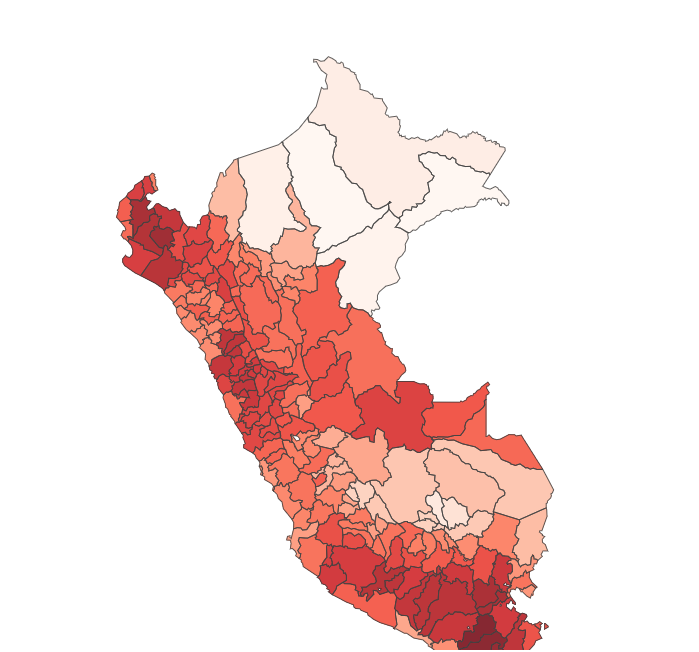
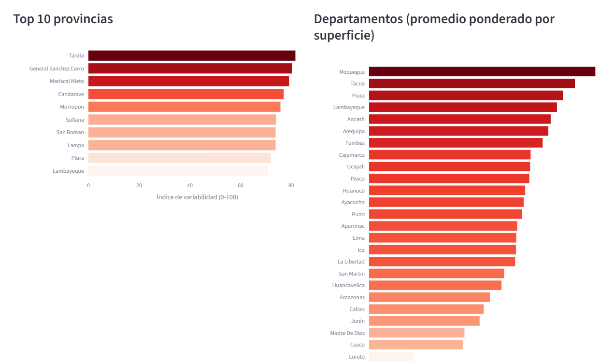
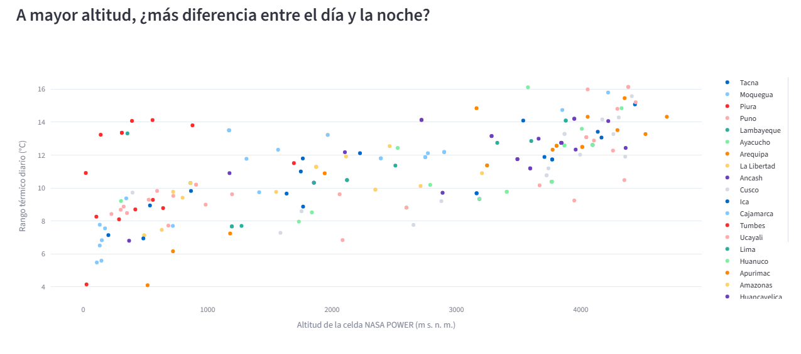

# ¿Qué territorios del Perú presentan mayores variaciones de temperatura o precipitación?

Tarea 3, Python Intermedio.

| | |
|---|---|
| 📊 **Dashboard interactivo** | https://clima-peru-abcgummraaqgys9jmpaqpb.streamlit.app/ |
| 💼 **Publicación de LinkedIn** | PEGAR_AQUI_EL_LINK_DE_LINKEDIN |
| 🎬 **Reel** | [reel/reel_clima_peru.mp4](reel/reel_clima_peru.mp4) |

## Tema y pregunta de investigación
**Tema:** variabilidad climática en el Perú, 1991-2025.

**Pregunta:** ¿Qué provincias y departamentos del Perú presentan las mayores variaciones de temperatura o
precipitación entre 1991 y 2025?

## Descripción del proyecto
El Perú reúne en poco espacio desierto costero, altiplano y selva amazónica. Este proyecto usa 35 años de datos
satelitales de la NASA para 195 provincias y mide **dónde el clima varía más**: entre el día y la noche, entre
estaciones, entre años y a largo plazo. Los resultados se pueden explorar en un dashboard interactivo y se resumen
en un reel de un minuto.

"Variación" se mide en cuatro dimensiones:

| Dimensión | Indicador | Qué significa |
|---|---|---|
| A. Diaria | Rango térmico (°C) | Diferencia entre la temperatura máxima y la mínima |
| B. Estacional | Amplitud estacional (°C) y % de lluvia entre diciembre y marzo | Diferencia entre el mes más cálido y el más frío; concentración de la lluvia |
| C. Entre años | Coeficiente de variación de la lluvia anual (%) | Qué tan distinto es un año de otro (por ejemplo, El Niño) |
| D. Largo plazo | Tendencia de temperatura (°C por década) y cambio de lluvia (últimos 15 años frente a los primeros 15) | Calentamiento y cambio en la lluvia |

El **índice de variabilidad (0-100)** promedia los percentiles del rango térmico, la amplitud estacional, el
coeficiente de variación de la lluvia y la tendencia de temperatura.

## Hallazgos principales

**1. La costa norte tiene la lluvia más irregular del país por El Niño.**
Sechura y Paita (Piura) tienen un coeficiente de variación de la lluvia anual de 175 % y 171 %, el más alto del
Perú. En 1998, durante El Niño 1997-98, llovió 9 veces más de lo normal en Paita y Sechura, y 7 veces más en la
provincia de Piura. Los picos se repiten en 2017 y 2023 (El Niño costero).


**2. En el altiplano la diferencia entre el día y la noche es cuatro veces mayor que en la costa.**
Lampa, San Román y Azángaro (Puno) tienen un rango térmico diario de 16 °C, frente a 4 °C en Camaná (Arequipa)
y Paita (Piura), donde el mar modera la temperatura. A mayor altitud, mayor rango (correlación de 0.67).


**3. El Perú se está calentando, y 2023-2024 fueron los años más cálidos del periodo.**
El 97 % de las provincias muestra una tendencia de calentamiento entre 1991 y 2025. 2023 y 2024 superaron el
promedio 1991-2020 en +1.10 °C y +1.39 °C, en coincidencia con El Niño 2023-24. El mayor calentamiento aparece
en Ucayali (0.6 a 0.7 °C por década en Atalaya, Padre Abad y Coronel Portillo).


**Índice compuesto.** Moquegua (76.8), Tacna (69.8) y Piura (65.8) tienen el clima más variable; Loreto (15.1),
el más estable.


## Dashboard
Tiene 4 KPIs, un mapa por provincia, rankings, series de tiempo, la relación con la altitud y una pestaña de
metodología. Los controles permiten elegir el indicador, filtrar por departamento, ajustar el rango de años y el
número de provincias del ranking.





## Fuentes de datos
- **NASA POWER**, API mensual por punto (reanálisis MERRA-2, celdas de unos 50 km): T2M, T2M_MAX, T2M_MIN,
  T2M_RANGE y PRECTOTCORR. https://power.larc.nasa.gov
- **Límites provinciales del INEI**, repositorio peru-geojson: https://github.com/juaneladio/peru-geojson

## Metodología
1. **Descarga** (`01_descargar.py`): un punto representativo dentro de cada provincia (siempre cae dentro del
   polígono) y su serie mensual 1991-2025 de NASA POWER.
2. **Limpieza** (`02_limpieza_indicadores.py`):
   - El mapa del INEI trae 197 polígonos: dos provincias partidas con el nombre mal escrito ("PUIRA" y
     "VICTOR FAFARDO"). Se unieron por código y quedan 195 provincias.
   - Se eliminó el "mes 13" (anual) que agrega NASA POWER; los anuales se recalculan.
   - Los valores -999 (faltantes) se convirtieron a NaN y se eliminaron duplicados.
   - La precipitación pasó de mm/día a mm por mes.
   - Solo se usan años completos (12 meses).
   - El coeficiente de variación de la lluvia no se calcula donde llueve menos de 100 mm al año, porque en el
     desierto costero cualquier llovizna lo dispara.
3. **Indicadores:** se calculan sobre el clima normal 1991-2020 (estándar de la OMM). Los departamentos son el
   promedio de sus provincias, ponderado por superficie.
4. **Hallazgos** (`03_hallazgos.py`): rankings, gráficos y resumen con cifras.
5. **Dashboard** (`app.py`): Streamlit y Plotly, publicado en Streamlit Community Cloud.

## Limitaciones
- Se toma un punto representativo por provincia. NASA POWER tiene celdas de unos 50 km, así que las provincias
  pequeñas (sobre todo en Lima y la costa) pueden compartir la misma celda, y la altitud de la celda es un
  promedio suavizado.
- Es un reanálisis, no una medición de estación: puede diferir de SENAMHI, sobre todo en la sierra.
- El mapa no incluye la provincia de Putumayo (Loreto), creada en 2014.
- El aumento de lluvia de +158 % en Castrovirreyna y de +99 % en Chupaca probablemente es un artefacto del
  reanálisis (cambios en los datos que asimila el modelo con el tiempo), no un cambio real; no se usa como hallazgo.
- El calentamiento de Ucayali (0.6-0.7 °C por década) es muy alto frente al resto del país, y algunas provincias
  entre Cusco y Madre de Dios muestran enfriamiento. Ambos casos deberían validarse con estaciones de SENAMHI.
- El índice compuesto es una construcción propia: cambia si se eligen otros componentes o pesos.

## Cómo ejecutarlo
```bash
python -m venv .venv
# Windows:   .venv\Scripts\activate
# Mac/Linux: source .venv/bin/activate
python -m pip install -r requirements.txt

python 01_descargar.py            # descarga (5-15 min)
python 02_limpieza_indicadores.py # limpieza e indicadores
python 03_hallazgos.py            # gráficos y hallazgos
python -m streamlit run app.py    # dashboard en http://localhost:8501
```
Cada script tiene celdas `# %%`: en VS Code se pueden correr una por una con **Run Cell**.

## Estructura
```
01_descargar.py              descarga de datos
02_limpieza_indicadores.py   limpieza e indicadores
03_hallazgos.py              gráficos y hallazgos
app.py                       dashboard (Streamlit)
data/raw/                    límites provinciales (los datos crudos de NASA no se suben)
data/processed/              datos limpios e indicadores
resultados/                  gráficos y hallazgos.md
capturas/                    capturas del dashboard
reel/                        reel en formato 9:16
```

## Uso de inteligencia artificial
- **Asistente de programación (Claude, de Anthropic):** apoyó en el diseño del análisis, el código en Python
  (descarga, limpieza, indicadores, gráficos y dashboard), la redacción de textos y el guion del reel, y el montaje
  del video. Yo ejecuté el código con los datos reales y revisé que las cifras y los hallazgos tuvieran sentido.
- **Voz del reel:** generada con IA (HERRAMIENTA_QUE_USASTE) a partir de una muestra de mi propia voz.
- **Música del reel:** generada por código (síntesis de acordes), sin derechos de autor de terceros.
- Las cifras provienen exclusivamente de los datos de NASA POWER procesados en este repositorio.
